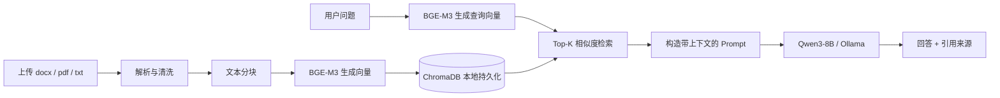

# RAG 学习项目规划

- 文档版本：v1.0.7
- 最后更新：2026-11-24
- 当前阶段：V1 学习版本已完成（阶段 0–7 代码、自动化验收、GitHub 文档整理和项目目录改名），并已发布到 GitHub
- 文档定位：本项目的单一事实来源。后续实现、验收和方案变更都以本文件为准。

> 更新规则：每完成一个阶段，更新“当前环境”“进度记录”“待确认事项”和“变更记录”；实际实现与本文不一致时，先改文档再继续开发。

> GitHub 文档入口：README.md 是项目首页，LEARNING_NOTES.md 记录 RAG 学习笔记，本文件保存详细规划、环境、阶段记录和变更日志。

---

## 1. 项目简介与最终目标

本项目用于个人学习 RAG（Retrieval-Augmented Generation，检索增强生成），通过亲手实现一个最小可用的本地知识库聊天助手，理解从文档到回答的完整链路。

最终目标：

1. 导入 Word、PDF、TXT 文档。
2. 读取并提取文档文字。
3. 对文本进行清洗和分块。
4. 使用 BGE-M3 将文本块转换为向量。
5. 使用 ChromaDB 创建本地持久化知识库。
6. 用户提问时，从知识库检索相关文本块。
7. 将“用户问题 + 检索结果”交给本地 Qwen3-8B。
8. 由 Qwen3-8B 基于检索结果生成带来源的回答。
9. 提供一个简单 Web 界面，用于上传文档、管理知识库和聊天。

### V1 范围

- 单用户、本机运行。
- 支持 `.docx`、`.pdf`、`.txt`。
- 支持知识库持久化，程序重启后数据仍然存在。
- 支持上传、查看文档列表、删除文档、聊天和查看引用来源。
- 只做基础向量检索，不做复杂 Agent、GraphRAG、多模态或复杂记忆。

### 非目标

- 不做注册、登录、权限和多用户。
- 不做商业化部署、Docker、Redis、微服务或云数据库。
- 不追求前后端分离。
- 不引入 LangChain、LlamaIndex 等大型框架作为核心依赖。
- 第一版不处理扫描版 PDF 的 OCR，不处理图片、语音和视频。

---

## 2. 当前环境与模型现状

### 2.1 已确认的环境

| 项目 | 实测结果 |
|---|---|
| 工作目录 | `RAG-learning`（项目根目录） |
| 项目文件 | 已创建 Python 项目配置、环境自检脚本和规划文档；已提交并推送到 GitHub `main` |
| 操作系统 | Windows 11（10.0.26300） |
| CPU / 内存 | ASUS ROG Strix G614JV，32 GB 内存 |
| GPU | NVIDIA GeForce RTX 4060 Laptop GPU，8188 MiB 显存；检查时约 6185 MiB 可用 |
| 默认 Python | Python 3.14.0（系统默认，未用于本项目） |
| Python 3.12 | 由 uv 管理的 CPython 3.12（具体路径由 uv 环境决定） |
| 项目虚拟环境 | `.venv`，Python 3.12.14，由 uv 管理 |
| 项目依赖 | `chromadb 1.5.9`、`httpx 0.28.1`、`python-docx 1.2.0`、`PyMuPDF 1.28.2`、`streamlit 1.67.0`；开发依赖 `pytest 9.2.0`、`ruff 0.17.4` |
| uv | 0.12.13 |
| uv 依赖源 | 阿里云 PyPI 镜像；当前网络解析 `pypi.org` 失败，镜像地址记录在 `pyproject.toml` |
| Ollama | 0.32.5，服务已在 `127.0.0.1:11434` 监听 |
| PyTorch | 2.11.0+cu128 |
| Transformers | 5.9.0 |
| 全局环境中的相关库 | `PyMuPDF 1.27.2.3`、`python-docx 1.2.0`、`fastapi`、`gradio`、`openai`、`huggingface_hub` |

说明：上述 Python 包属于全局 Python 3.14 环境，不代表项目环境。项目将单独创建 Python 3.12 虚拟环境，避免 3.14 下部分 AI/向量数据库依赖没有可用 wheel 的风险。

Embedding 最终没有使用项目内 `sentence-transformers`，而是复用 Ollama 的 HTTP Embedding API，因此不需要在 Python 3.12 环境中额外安装 PyTorch 或 `sentence-transformers`。

ChromaDB 固定为 `1.5.9`，并带有 `onnxruntime`、`numpy`、`tokenizers` 等传递依赖。项目显式传入已生成的向量，并把 Collection 的 `embedding_function` 设为 `None`，不会触发 ChromaDB 默认的 Embedding 模型下载。

Streamlit 已安装为 `1.67.0`。由于当前网络无法解析 `pypi.org`，安装时使用了阿里云 PyPI 镜像，`pyproject.toml` 中记录了该索引；切换网络后如不使用镜像，可以移除对应配置。

### 2.2 模型现状

| 模型 | 状态 | 说明 |
|---|---|---|
| Qwen3-8B | 已可用 | 通过 Ollama `qwen3:8b` 使用；8.2B；Q4_K_M；5.2GB；最大上下文 40960 |
| BGE-M3 | 已可用 | Ollama `bge-m3` / `bge-m3-cpu`；566.70M；F16；模型约 1.2GB；Embedding 1024 维 |
| Qwen-7B-Chat | 存在旧缓存 | 不是本项目的目标模型 |
| Ollama 现有模型 | `bge-m3:latest`、`bge-m3-cpu:latest`、`qwen3:8b`、`minicpm-v:8b` | Qwen 使用 `qwen3:8b`；Embedding 使用派生模型 `bge-m3-cpu` |

阶段 1 已验证：

1. 模型由 Ollama 管理，默认目录由 Ollama 配置决定。
2. `ollama pull qwen3:8b` 已完成，文件大小 5.2GB。
3. Ollama API 为 `http://127.0.0.1:11434`。
4. `uv run python scripts/check_env.py --chat` 通过，返回 `模型可用`。
5. Ollama 支持 `think: false`，自检请求已关闭思考模式。

当前不下载、不使用 Qwen3-8B 的完整 BF16 权重；本项目使用 Ollama 的 Q4_K_M 版本。

阶段 3 已验证：

1. `ollama pull bge-m3` 完成并通过 SHA-256 校验，模型文件约 1.2GB。
2. `ollama show bge-m3` 显示：BERT 架构、566.70M 参数、F16、上下文长度 8192、Embedding 维度 1024。
3. `Modelfile.bge-m3-cpu` 使用 `PARAMETER num_gpu 0` 创建 `bge-m3-cpu`。
4. `ollama ps` 实测 `bge-m3-cpu` 为 1.2GB、`100% CPU`，没有占用 Qwen 所需的 GPU 显存。
5. 4 条短文本批量向量化耗时约 3.2 秒；3 份演示文档解析出 6 个块并向量化耗时约 0.5 秒。
6. 项目 Python 环境未安装 `sentence-transformers`，Embedding 完全通过 Ollama `/api/embed` 完成。

阶段 6 已验证：

1. `ollama ps` 显示 `qwen3:8b` 加载约 5.6GB，`100% GPU`，上下文 4096；`bge-m3-cpu` 约 1.2GB，`100% CPU`。
2. Qwen 和 BGE-M3 可以同时驻留，但显存余量已经很小，后续应避免再加载其他 GPU 模型。
3. 真实 RAG 问答中，可回答题耗时约 7.40 秒，无法回答题约 1.53 秒，易混淆题约 1.53 秒，多证据题约 2.09 秒。
4. 生成阶段关闭 thinking，设置 `temperature=0.1`、`num_predict=512`，避免无意义的长输出。

### 2.3 显存约束

RTX 4060 Laptop 只有 8 GB 显存：

- Qwen3-8B 的 BF16/FP16 权重约 16 GB，不能完整常驻这张显卡。
- 4-bit 量化的 8B 模型通常约 5 GB，加上 KV Cache 和运行时开销，才比较适合 8 GB 显存。
- 阶段 1 实测：模型加载后，Ollama 显示模型占用约 5.6GB、100% GPU；`nvidia-smi` 显示显存使用约 7396 MiB / 8188 MiB，仅剩约 562 MiB。
- 阶段 3 实测：通过 `bge-m3-cpu` 运行时，`ollama ps` 显示 `100% CPU`；Embedding 模型不占用 Qwen 的 GPU 空间。

因此，Qwen3-8B 继续使用 GPU，BGE-M3 固定使用 CPU。不要直接使用基础模型 `bge-m3` 做 Embedding，否则 Ollama 可能把它加载到 GPU；项目统一使用 `bge-m3-cpu`。CPU Embedding 会慢于 GPU，但本项目文档规模很小，先优先保证 Qwen 有足够显存。

如果其他 GPU 程序仍然缺显存，可以先用 `ollama stop qwen3:8b` 卸载 Qwen；BGE-M3 CPU 模型不受影响。

---

## 3. 技术选型

| 组件 | 选择 | 作用 | 选择理由 |
|---|---|---|---|
| 语言 | Python 3.12 | 项目开发 | 生态兼容性优于 3.14，现有 uv 可直接复用 |
| 环境与依赖 | `uv` + `.venv` + `pyproject.toml` | 隔离项目环境、固定依赖 | 快速、可复现，避免污染全局 Python |
| LLM | Qwen3-8B | 根据检索内容生成回答 | 用户已有模型，目标是本地运行 |
| LLM 推理 | 优先 Ollama；根据实际模型格式调整 | 提供本地 HTTP 推理接口 | Ollama 已安装，API 简单，适合学习项目 |
| Embedding | BGE-M3 | 文档块和问题的向量化 | 中文和多语言检索表现合适，维度信息明确 |
| Embedding 运行方式 | Ollama `/api/embed` + `bge-m3-cpu`（`PARAMETER num_gpu 0`） | 生成文档块和查询向量 | 复用已有 Ollama，避免项目额外安装 PyTorch / `sentence-transformers`；CPU 版避免和 Qwen 抢显存 |
| 向量数据库 | ChromaDB `1.5.9` + `PersistentClient` | 保存文本块、向量和元数据 | 本地持久化、API 简单，符合学习项目规模 |
| Word 解析 | `python-docx` | 提取 `.docx` 段落 | 直接、轻量 |
| PDF 解析 | PyMuPDF / `fitz` | 提取 PDF 文字和页码 | 速度快，能保留页码信息 |
| TXT 解析 | Python 标准库 + 编码检测 | 读取纯文本 | 不引入不必要依赖 |
| Web UI | Streamlit | 上传、知识库管理、聊天 | 单文件即可完成简单界面，开发成本低 |
| 测试 | `pytest` | 验证解析、分块、检索 | 让每阶段结果可验证 |
| 代码检查 | `ruff` | 格式和静态检查 | 轻量，适合个人项目 |

### 暂不引入的组件

- LangChain / LlamaIndex：会隐藏分块、Embedding、检索和 Prompt 的具体过程，不利于学习。
- FastAPI + React：当前只需要单机 Web UI，前后端分离成本过高。
- Redis、Docker、云数据库、消息队列：没有实际需求。
- Reranker、混合检索、查询改写、GraphRAG：作为后续可选优化，不进入 V1 主流程。

### 技术调整原则

如果实际环境与上表冲突，按以下顺序调整：

1. 先保证 Qwen3-8B 能稳定运行。
2. 再保证 RAG 主链路完整。
3. 最后才考虑性能和效果优化。

每次调整都要在本文件记录原因、影响和回滚方式，不能只改代码不改文档。

---

## 4. 整体架构与 RAG 工作流



### 建库流程

1. 用户上传文档。
2. 根据文件类型选择解析器，提取文字。
3. 清洗无意义空白、页眉页脚和重复内容（第一版只做基础清洗）。
4. 按字符数或段落边界切块，保留少量重叠。
5. 用 BGE-M3 为每个文本块生成向量。
6. 将文本块、向量和元数据写入 ChromaDB。

### 问答流程

1. 用户输入问题。
2. 用同一个 BGE-M3 模型把问题转成向量。
3. ChromaDB 按向量相似度返回 Top-K 文本块。
4. 把检索结果编号后放入 Prompt。
5. Qwen3-8B 根据上下文生成回答。
6. 界面展示回答和引用来源。

### 检索元数据

每个文本块实际保存：

- `source`：原始文件名，当前也是 V1 的来源标识。
- `file_type`：`docx`、`pdf` 或 `txt`。
- `chunk_index`：文本块在文档中的序号。
- `start_char` / `end_char`：文本块在原段落文字中的起止位置。
- `page`：PDF 页码；其他格式没有该字段。
- `paragraph`：DOCX 段落序号；其他格式没有该字段。

V1 尚未引入 `doc_id`、`created_at` 和 `file_hash`。因此同名文件会被视为同一来源并覆盖旧索引；原始文件保留在 `data/uploads`。

### 关键原则

- 检索质量决定 RAG 质量。生成模型不能可靠地“猜”出知识库里没有的内容。
- 文档块必须保留来源信息，否则回答无法追溯。
- 问题和文档必须使用同一个 Embedding 模型，向量维度必须一致。
- 分块大小不能凭感觉固定，后续要用真实文档和检索评估调整。
- Prompt 要明确要求“只根据给定资料回答；资料不足时直接说明”。

---

## 5. 项目目录结构

阶段 0～7 的文件已经落地；V1 只差用户在本机浏览器中的手动验收。

```text
RAG_LEARNING_PROJECT.md
pyproject.toml
uv.lock
env.example
.gitignore
Modelfile.bge-m3-cpu   # 从 bge-m3 派生 CPU-only Embedding 模型

app/
  __init__.py
  config.py          # 路径、模型名、Top-K 等配置
  loaders.py         # docx / pdf / txt 解析
  chunking.py        # 清洗与文本分块
  embeddings.py      # BGE-M3 加载与向量化
  vector_store.py    # ChromaDB 写入、读取、删除、计数和语义检索
  retrieval_eval.py  # 证据到 chunk 的映射与检索指标
  llm.py             # Ollama / Qwen3-8B 客户端
  rag.py             # 检索 + Prompt + 生成
  ingestion.py       # 可复用的文档入库服务，CLI 与 UI 共用
  ui_helpers.py      # 上传文件校验、保存和来源格式化
  ui.py              # Streamlit 单页界面

scripts/
  check_env.py       # 环境自检
  ingest.py          # 命令行建库，调用 app/ingestion.py
  query.py           # 命令行问答；--retrieval-only 为纯检索
  evaluate_retrieval.py # 40 条问题的检索基线评估

data/
  uploads/           # 上传的原始文档
  chroma/            # ChromaDB 持久化目录
  eval/
    mianyang_synthetic_v1/
      docs/          # 8 份完全虚构的规则测试文档
      questions.json # 40 条带证据标注的检索评估问题
      eval_results.json # 最近一次检索评估结果
      runtime_chroma/ # 合成测试集独立知识库，不污染正式 data/chroma

tests/
  test_loaders.py
  test_chunking.py
  test_embeddings.py
  test_vector_store.py
  test_retrieval_eval.py
  test_llm.py
  test_rag.py
  test_ingestion.py
  test_ui_helpers.py
  test_ui.py
```

约定：

- `data/`、`.venv/`、模型文件和 `.env` 不提交到 Git。
- 不把 API Key、Token 或密码写进代码；即使本项目默认本地运行，也保留 `env.example` 说明配置项。
- 先命令行跑通，再接 Streamlit；这样出问题时能判断是 RAG 链路还是界面问题。

---

## 6. 分阶段学习与开发计划

### 推进规则

每个阶段严格按以下顺序进行：

1. 先说明本阶段目标、涉及原理和为什么需要这一步。
2. 给出本阶段的操作步骤和可复制命令。
3. 由用户执行命令或操作软件。
4. 检查实际输出，不根据“应该成功”下结论。
5. 解释本阶段实现了什么，以及代码与技术概念的关系。
6. 更新本文件中的进度和实际结果。
7. 等用户确认后，再进入下一阶段。

不一次性输出所有阶段的详细命令，不连续自动推进多个阶段。

---

### 阶段 0：调研与项目规划（已完成）

目标：确认现状，确定技术方案和阶段边界。

已完成：

- 检查当前目录、Git 状态和已有文件。
- 检查 Python、GPU、Ollama、关键依赖和模型缓存。
- 记录 Qwen3-8B、BGE-M3 尚未确认的事实。
- 制定技术选型和分阶段计划。

验收标准：

- 本文件存在并覆盖项目目标、架构、目录、阶段和验收标准。
- 未编写实际项目代码。
- 未在未确认模型格式的情况下擅自下载或覆盖模型。

---

### 阶段 1：Python 环境与 Qwen3-8B 接入（已完成）

完成日期：2026-11-12

目标：建立可复现的项目环境，确认 Qwen3-8B 的实际运行方式，并让模型能通过本地 API 回答一个简单问题。

需要理解的原理：

- 虚拟环境的作用是隔离依赖。
- LLM 推理服务把模型加载和文本生成封装成 HTTP API。
- 量化通过降低权重精度减少显存占用，但可能损失少量效果。
- 8 GB 显存下，模型格式和上下文长度必须一起考虑。

主要任务：

- 确认 Qwen3-8B 的路径、格式和完整性。
- 用 Python 3.12 创建 uv 项目和 `.venv`。
- 安装最小依赖，先不安装 RAG 相关库也可以。
- 复用或启动 Ollama，验证 Qwen3-8B 的一次普通问答。
- 记录模型标识、API 地址、上下文长度、首次加载时间和显存占用。
- 编写 `scripts/check_env.py`，输出 Python、依赖、模型服务和显存的基本状态。

交付物：

- `pyproject.toml`、`uv.lock`、`.venv`。
- `env.example`、`.gitignore`、`app/config.py`。
- `scripts/check_env.py`。
- 一段真实的模型调用记录。

验收标准：

- `uv run python scripts/check_env.py --chat` 能正常执行。
- Qwen3-8B 能返回中文回答。
- 运行过程中不出现显存溢出。
- 文档记录实际模型路径和启动方式，而不是“推测可用”。

阶段结束记录：

- 实际模型：Ollama `qwen3:8b`，由 Ollama 模型库管理，默认目录由 Ollama 配置决定
- 模型格式 / 量化：GGUF / Q4_K_M，8.2B，约 5.2GB
- API 地址：`http://127.0.0.1:11434`
- 最大上下文：40960；自检时实际加载上下文：4096
- 生成速度：模型已加载时，`--chat` 简单请求约 0.23 秒；首次加载会明显更慢
- 显存占用：模型加载后约 7396 MiB / 8188 MiB，剩余约 562 MiB
- 自检结果：`OK: Stage 1 environment checks passed`
- 代码检查：`uv run ruff check .` 通过，`uv run ruff format --check .` 通过

---

### 阶段 2：Word / PDF / TXT 文档读取（已完成）

完成日期：2026-11-12

目标：把三种格式的文档转换成带来源信息的纯文本。

需要理解的原理：

- RAG 的第一步不是“给模型看文件”，而是先由程序把文件解析成文本。
- PDF 的“文字层”和“扫描图片”不同；扫描件需要 OCR，本阶段不处理。
- 页码、文件名、段落位置等元数据会影响后续引用。

主要任务：

- 实现 `.docx`、`.pdf`、`.txt` 三个加载函数。
- 统一输出结构：文本、文件名、文件类型、页码或段落信息。
- 处理空文件、损坏文件和不支持的后缀。
- 用三种真实小文档测试。

交付物：

- `app/loaders.py`。
- `tests/test_loaders.py`。
- 三种格式的解析结果示例。

验收标准：

- 三种格式都能读出非空文本。
- PDF 能保留页码。
- 单个文件解析失败时给出明确错误，不导致整个程序崩溃。
- 此阶段不生成向量、不写 ChromaDB。

阶段结束记录：

- 实现 `app/loaders.py`，统一输出 `DocumentSection`：文本、来源文件、文件类型、页码或段落序号。
- TXT 支持 UTF-8（含 BOM）、GB18030 和带 BOM 的 UTF-16。
- DOCX 按非空段落提取，并保留段落序号。
- PDF 按页提取文字，页码从 1 开始；加密 PDF 和扫描件会给出明确错误。
- `tests/test_loaders.py` 共 8 个测试全部通过。
- 演示解析结果：`demo.txt` 1 段、`demo.docx` 3 段、`demo.pdf` 2 页，来源和页码均正确。
- `uv run ruff check .` 和 `uv run ruff format --check .` 均通过。

本阶段限制：

- DOCX 目前只读取正文段落，不读取表格、页眉页脚和批注。
- PDF 只读取文字层，扫描版 PDF 不做 OCR。
- TXT 的编码识别采用常见编码回退，不保证识别所有冷门编码。

---

### 阶段 3：文本分块与 BGE-M3 Embedding（已完成）

完成日期：2026-11-15

目标：把长文本切成适合检索的块，并理解文本如何变成向量。

需要理解的原理：

- 文本块太大，检索不够精确；太小，上下文不完整。
- 重叠区域用于避免关键句被切断。
- Embedding 把文本映射到高维向量，语义相近的文本在向量空间中更接近。
- 余弦相似度衡量两个向量的方向接近程度。

主要任务：

- 编写基础清洗和分块函数。
- 初始参数建议：约 500 个中文字符一块，重叠约 80 个字符；最终以阶段 5 的实际评估为准。
- 保留 `source`、`page`、`chunk_index` 等元数据。
- 加载 BGE-M3，生成文档块向量和查询向量。
- 做一个小实验：比较两个语义相近句子和两个无关句子的相似度。

交付物：

- `app/chunking.py`。
- `app/embeddings.py`。
- `tests/test_chunking.py`。
- 一组真实文本的向量和相似度结果。

验收标准：

- 分块后不丢失原文关键信息。
- 每个块都有可追溯的来源元数据。
- 所有向量维度一致。
- 相似语义样本的分数明显高于无关样本。
- 记录 Embedding 使用 CPU 还是 GPU，以及单次耗时。

阶段结束记录：

- 分块实现：`chunk_sections()` 按 500 字符窗口、80 字符重叠切分，优先在中文/英文句末或换行处断开。
- 每个 `TextChunk` 保留 `source`、`file_type`、`page`、`paragraph`、`chunk_index`、`start_char`、`end_char`。
- Embedding 实现：`embed_texts()` 批量调用 Ollama `/api/embed`，`embed_query()` 处理单个问题，`cosine_similarity()` 计算余弦相似度。
- 实际模型：`bge-m3-cpu`，由 `bge-m3` 加上 `PARAMETER num_gpu 0` 派生；F16；Embedding 维度 1024。
- 运行设备：`ollama ps` 显示 1.2GB、`100% CPU`；运行 Embedding 时 GPU 显存未被该模型占用。
- 模型上下文：基础模型标称 8192，Ollama 当前实际加载上下文为 4096；当前 500 字符块远小于该限制。
- 语义实验：`猫喜欢晒太阳` 与 `小猫在阳光下休息` 的余弦相似度为 0.8394；与 `股票市场今天下跌` 为 0.3469，与 `Python 是一种编程语言` 为 0.3341。
- 完整链路实验：`demo.docx`、`demo.pdf`、`demo.txt` 共解析 6 个 section、生成 6 个块和 6 个 1024 维向量，耗时约 0.502 秒。
- 测试结果：`tests/test_chunking.py` 11 个、`tests/test_embeddings.py` 8 个，全项目共 27 个测试通过。
- 代码检查：`uv run ruff check .` 通过，`uv run ruff format --check .` 通过。
- 环境自检：`uv run python scripts/check_env.py` 通过，并同时检查 Qwen 与 BGE-M3 模型是否存在。
- 本阶段没有创建 ChromaDB 集合，也没有写入任何向量数据库。

本阶段限制：

- 分块仍按字符数近似 token 数，没有使用 BGE-M3 tokenizer；阶段 5 用检索评估决定是否调整。
- 当前使用 CPU Embedding，批量文档较大时速度会明显慢于 GPU。
- 文档清洗只做基础空白处理；表格、页眉页脚和扫描件仍不在本阶段范围内。

---

### 阶段 4：ChromaDB 知识库（已完成）

完成日期：2026-11-15

目标：把文本块、向量和元数据持久化到本地 ChromaDB。

需要理解的原理：

- ChromaDB 保存的是“文档 + 向量 + 元数据”的组合。
- Collection 类似一个知识库表。
- 向量检索通过距离度量找出与查询向量最接近的记录。
- 持久化目录必须固定，否则重启后会误以为数据丢失。

主要任务：

- 创建 `PersistentClient(path="data/chroma")`。
- 创建固定名称的 Collection。
- 实现添加、查询、按来源删除和统计数量。
- 用稳定 chunk ID 和 `upsert` 避免重复入库；V1 暂未引入独立 `file_hash`。
- 对同一批文档重复执行一次入库，验证不会产生重复块。

交付物：

- `app/vector_store.py`。
- `scripts/ingest.py`。
- `tests/test_vector_store.py`。

验收标准：

- 入库后 Collection 数量与预期一致。
- 关闭程序再启动，数据仍然存在。
- 能按文件名删除对应文本块。
- 能输出每条结果的文本和来源元数据。

阶段结束记录：

- 安装并固定 `chromadb==1.5.9`；持久化文件为 `data/chroma/chroma.sqlite3`。
- 创建 `VectorStore`，使用 `PersistentClient`、Collection `knowledge_base`、余弦距离和 `embedding_function=None`。
- `add_chunks()` 写入文本、向量和元数据；chunk ID 由 `source + chunk_index` 稳定生成，重复写入使用 `upsert` 更新而不是新增。
- `get_records()` 可按来源读取文本与元数据；`source_counts()` 统计每个文档的块数；`delete_by_source()` 只删除指定来源。
- `scripts/ingest.py` 串通“文档解析 → 分块 → BGE-M3 Embedding → ChromaDB 写入”。
- 演示文档实际结果为：`demo.docx` 3 块、`demo.pdf` 2 块、`demo.txt` 1 块，共 6 块。
- 连续执行两次建库后仍为 6 块，说明重复执行不会无限增加数据。
- 在另一个 Python 进程中重新创建 `VectorStore`，仍读取到 6 块和三个来源，持久化验证通过。
- `tests/test_vector_store.py` 共 8 个测试通过；全项目共 35 个测试通过。
- `uv run ruff check .` 和 `uv run ruff format --check .` 均通过；`uv run python scripts/check_env.py` 通过。

本阶段限制：

- 尚未实现语义检索；`get_records()` 只是按来源读取记录，不能按相似度排序。
- 文档身份暂时使用文件名 `source`，不同目录下的同名文件会互相覆盖；后续需要文档管理时再引入 `doc_id` 或 `file_hash`。
- 当前只删除或更新整个来源；没有按单个 chunk 编辑的功能，V1 不需要。
- ChromaDB 的 SQLite 文件属于本地数据，不提交到 Git；删除 `data/chroma` 等于清空知识库。

---

### 阶段 5：知识检索与检索评估

目标：只用检索、不接 LLM，先判断“能不能找对资料”。

需要理解的原理：

- RAG 的很多错误来自检索错误，而不是生成模型错误。
- `Top-K` 是返回最相似的 K 个块。
- `Recall@K` 衡量正确资料是否出现在前 K 个结果中。
- `Precision@K` 衡量返回结果中有多少是相关的。
- 分块参数应该根据真实文档和评估结果调整，不能只凭直觉。

主要任务：

- 实现查询向量化和 Top-K 检索。
- 实现 `scripts/query.py --retrieval-only`。
- 使用 `data/eval/mianyang_synthetic_v1` 中的 8 份虚构文档和 40 条问题建立基线。
- 计算 `Hit@5`、`Recall@5`、`MRR@5`；`Precision@5` 作为辅助指标。
- 记录无法回答问题的 top-1 相似度分布；真正的拒答准确率留到阶段 6 和生成阶段评估。
- 每次只改一个变量（分块大小、重叠、Top-K），重新评估。

评估注意：

- 由于分块使用 80 字重叠，同一证据片段可能同时落在相邻两个块中。
- 评估时只要检索结果包含任意一个匹配块，就算命中；后续需要记录证据到多个 chunk ID 的映射。
- 40 条问题覆盖单跳、同义改写、多证据、易混淆和无法回答五类，不能只挑简单题评估。

交付物：

- `scripts/query.py` 的纯检索模式。
- `data/eval/mianyang_synthetic_v1` 中的文档、问题和证据标注。
- 检索评估结果。

验收标准：

- 查询能返回相关文本块及其来源。
- 有基线指标，而不是只看“感觉还行”。
- 40 条问题都有明确的评估处理方式；无法回答题不能被强行配上证据。
- 首版目标可设为 `Recall@5 >= 0.8`；如果达不到，先分析失败原因，不硬凑指标。
- 此阶段不调用 Qwen3-8B 生成答案。

实施结果：

- `VectorStore.search()` 已实现，返回文本、来源元数据、余弦距离和相似度。
- 单元测试确认 ChromaDB 的余弦距离符合 `distance = 1 - similarity`：同向向量距离约 0，正交向量距离约 1。
- `scripts/query.py --retrieval-only` 已能输出 Top-K 文本块、来源、chunk 序号、距离和相似度。
- `scripts/evaluate_retrieval.py` 使用临时 ChromaDB 建库，不会修改 `data/chroma`。
- 40 条问题中 34 条可回答、6 条无法回答；答案证据先按“一条证据对应一组匹配块”处理，避免重叠块被重复计算。
- 实测基线：`Hit@5 = 1.0000`、`Recall@5 = 1.0000`、`Precision@5 = 0.2176`、`MRR@5 = 0.9559`，40 条问题总耗时约 9.8 秒。
- 有 3 条问题正确证据排在第 2 位，因此 MRR 略低于 1；没有完全漏检的题目。
- 可回答问题的 top-1 相似度均值约 0.658，无法回答题约 0.589；两组范围重叠，不能仅靠相似度阈值可靠拒答。

本阶段限制：

- 测试集只有 16 个块，规模很小，指标偏高不能直接外推到真实文档。
- `Precision@5` 偏低主要是因为多数问题只有一条证据，而 Top-5 会返回其余相邻主题块；它不等于检索失败。
- 无法回答题在纯检索阶段无法真正拒答，当前只记录相似度分布；拒答要依赖阶段 6 的 Prompt 和生成行为。
- 还没有做分块大小、重叠和 Top-K 的参数对比，本轮只建立基线。

---

### 阶段 6：连接 Qwen3-8B，实现 RAG 问答

目标：把检索结果和问题一起交给 Qwen3-8B，生成有依据的回答。

需要理解的原理：

- LLM 本身不知道我们的私有知识库，检索结果通过 Prompt 临时提供上下文。
- 上下文长度有限，不能把所有文档都塞进去。
- Prompt 需要要求模型区分“资料中的内容”和“自己的推测”。
- 引用编号让用户能回到原文核对。

主要任务：

- 实现 `app/llm.py`，通过 Ollama API 调用 Qwen3-8B。
- 实现 `app/rag.py`：问题 → 检索 → 构造 Prompt → 生成。
- 给检索结果编号，要求回答使用 `[1]`、`[2]` 标注来源。
- 明确要求资料不足时回答“知识库中没有足够信息”，不要编造。
- 限制送入模型的文本总量，并记录截断策略。
- 先做命令行问答，不接界面。

交付物：

- `app/llm.py`。
- `app/rag.py`。
- `scripts/query.py` 的问答模式。

验收标准：

- 回答能引用至少一个真实来源。
- 问知识库中不存在的问题时，模型能明确表示资料不足。
- 检索到的来源和回答内容基本一致，没有明显张冠李戴。
- 记录一次完整请求的耗时和上下文块数量。

实施结果：

- `app/llm.py` 已实现 Ollama `/api/chat` 调用，默认 `stream=False`、`think=False`、`temperature=0.1`、`num_predict=512`、超时 180 秒。
- `app/rag.py` 已实现检索结果编号、上下文预算截断、Prompt 组装、资料不足拒答和来源返回。
- `scripts/query.py` 默认进入问答模式，保留 `--retrieval-only` 用于只检索对照。
- 合成测试知识库独立存放在 `data/eval/mianyang_synthetic_v1/runtime_chroma`，没有污染现有 `data/chroma`。
- 真实问答验证：
  - “补考成绩最高按多少分记入成绩单？”回答“60 分”，引用 `[2]`，耗时约 7.40 秒。
  - “学校食堂晚上几点关门？”回答“知识库中没有足够信息”，耗时约 1.53 秒。
  - “选修课不及格后可以参加补考吗？”回答“不可以，可重修或改选”，耗时约 1.53 秒。
  - “休学最多可以累计多久？复学要提前多少天申请？”同时回答“2 学年”和“30 天”，耗时约 2.09 秒。
- 独立来源列表始终打印在回答下方，即使模型引用编号不稳定，也能核对实际使用的文本块。

本阶段限制：

- 模型可能引用错误编号或漏掉编号；当前用独立来源列表兜底，尚未做严格的自动引用校验。
- 目前是单轮问答，没有聊天历史记忆。
- 没有重排、查询改写或多轮检索；Top-K 仍固定为 5。
- 合成文档很短，回答质量不能直接代表真实长篇文档。

---

### 阶段 7：Streamlit 聊天界面与端到端验收（已完成）

状态：代码与自动化验收已完成（2026-11-16）；待白雫在本机浏览器中手动验收。

目标：把建库、检索和问答串成一个可日常使用的简单 Web 应用。

需要理解的原理：

- Streamlit 每次交互会重新运行脚本，聊天记录要用 Session State 保存。
- 上传文件、建库和聊天是三个不同的状态，界面要避免重复入库。
- 界面层只负责交互，核心 RAG 逻辑仍然放在独立模块中。

主要任务：

- 页面上传文档并触发建库。
- 显示已入库文档列表和块数量。
- 支持删除单个文档的索引。
- 提供聊天输入框、回答区域和来源展开区。
- 支持清空当前聊天记录。
- 提示模型服务不可用、文件解析失败和空知识库等异常。

交付物：

- `app/ui.py`：单页界面，含上传、知识库列表、删除、聊天和来源展开。
- `app/ingestion.py`：CLI 与 UI 共用的文档入库服务。
- `app/ui_helpers.py`：上传文件名校验、保存和来源格式化。
- `tests/test_ingestion.py`、`tests/test_ui_helpers.py`、`tests/test_ui.py`。
- 自动化与真实 Ollama 冒烟验证记录。

验收标准：

- 能上传三种格式并成功建库：已用 `demo.txt`、`demo.pdf`、`demo.docx` 验证，共 6 块。
- 能提问、得到回答并查看来源：真实 Qwen 请求通过，回答引用 `demo.txt`、`demo.pdf`、`demo.docx`。
- 重启应用后知识库仍然存在：新进程读取同一临时库，仍为 6 块。
- 删除文档后，对应文本块不再被检索：删除 `demo.pdf` 后从 6 块变为 4 块，来源列表只剩 TXT/DOCX。
- Ollama 不可用时界面不崩溃：自动化测试验证会显示“请确认 Ollama 已启动”的可操作提示。
- Streamlit 服务可启动：健康检查返回 `200 ok`。
- 没有把密钥、模型文件或数据库文件提交到 Git：`data/`、`.env`、`.venv/` 均在 `.gitignore` 中。

已知限制：

- 同名文件仍按文件名覆盖；界面已提示，但 V1 不提供重命名冲突处理。
- 聊天记录只存在当前 Streamlit Session State，刷新新会话后不会保留。
- 引用编号可能由模型写错；界面会独立展示实际检索来源，尚未自动校验编号。
- 上传文件大小上限为 50 MB；扫描版 PDF 仍需 OCR，V1 不支持。

---

## 7. V1 最终验收标准

### 功能

- 支持 `.docx`、`.pdf`、`.txt` 导入。
- 文档能解析、清洗、分块并生成向量。
- ChromaDB 能持久化保存知识库。
- 用户提问能检索相关文本块。
- Qwen3-8B 能基于检索内容生成回答并显示来源。
- 能管理文档列表和删除索引。

### 质量

- 有至少 40 个问题的检索评估记录。
- 首版以 `Recall@5 >= 0.8` 为参考目标，达不到时记录原因。
- 回答必须尽量基于给定资料，资料不足时明确说明。
- 回答中的引用编号能对应到检索来源。

### 运行

- 重启程序后知识库仍然可用。
- 不需要重新下载已有 Qwen3-8B 模型。
- 不依赖云 API 才能完成核心问答。
- 不出现密钥硬编码。
- 8 GB 显存下能完成基本问答；如果必须降级，记录实际降级方式。

### 学习

- 能解释文档解析、分块、Embedding、向量检索和 Prompt 组装分别做什么。
- 能通过修改 `Top-K` 和分块参数观察结果变化。
- 能根据检索失败案例判断问题出在资料、分块还是生成阶段。

---

## 8. 进度记录

| 阶段 | 状态 | 实际结果 / 备注 | 更新时间 |
|---|---|---|---|
| 阶段 0：调研与规划 | 已完成 | 已检查目录、Python、GPU、Ollama、模型缓存；创建本规划文档 | 2026-11-12 |
| 阶段 1：环境与 Qwen3-8B 接入 | 已完成 | Python 3.12 环境、Ollama Qwen3-8B、自检脚本和一次真实问答均通过 | 2026-11-12 |
| 阶段 2：文档读取 | 已完成 | `app/loaders.py` 和 8 个测试通过；TXT/DOCX/PDF 均可解析并保留来源、页码或段落 | 2026-11-12 |
| 阶段 3：分块与 Embedding | 已完成 | Ollama `bge-m3-cpu`、1024 维、100% CPU；分块/向量化链路和 19 个测试通过 | 2026-11-15 |
| 阶段 4：ChromaDB 知识库 | 已完成 | ChromaDB 1.5.9；写入、读取、删除和计数实现；演示文档 6 块；新进程持久化验证通过；8 个测试通过 | 2026-11-15 |
| 阶段 5：检索与评估 | 已完成 | 实现 `search()`、纯检索 CLI 和自动评估；40 条问题基线 `Hit@5=1.0`、`Recall@5=1.0`、`MRR@5=0.9559`；49 个测试通过 | 2026-11-15 |
| 阶段 6：RAG 问答 | 已完成 | `app/llm.py`、`app/rag.py` 和问答 CLI 完成；真实 Qwen 回答、拒答、引用来源和多证据测试通过；62 个测试通过 | 2026-11-16 |
| 阶段 7：Web 界面与验收 | 已完成 | Streamlit 单页界面、上传校验、知识库管理、聊天和来源展示完成；真实 Ollama 冒烟通过；全项目 82 个测试通过 | 2026-11-17 |

当前进行中：

- 无代码开发进行中。
- 阶段 7 代码和自动化验收已完成；GitHub 文档整理和首次发布已完成。
- 如果还需要最终归档，可在本机浏览器补做一次上传、建库、问答和删除验收。

---

## 9. 待确认事项

阶段 7 相关选择已确认：

1. 使用单个 `app/ui.py` 完成上传、知识库管理和聊天，不拆前后端。
2. 界面显示回答引用来源，并允许展开查看原文块。
3. 使用 Streamlit Session State 保存当前聊天记录，不做持久化历史。
4. 先完成上传、建库、聊天、删除文档的最小闭环，再考虑视觉优化。

仍需白雫确认：

1. 是否在本机浏览器补做一次最终归档验收；如果已经完成，可以直接跳过。
2. 是否把 V1 标记为最终完成；后续再决定是否做引用编号校验、重排或更长文档测试。

已确定但可调整的默认选择：

- Python 3.12 + uv。
- Ollama 作为 Qwen3-8B 的首选推理服务。
- BGE-M3 统一使用 Ollama `bge-m3-cpu`，在 CPU 上运行，避免和 Qwen 抢显存。
- 初始分块约 500 字符、重叠约 80 字符。
- RAG 问答默认关闭 Qwen3 的 thinking，降低延迟和 token 消耗。
- ChromaDB 使用 `PersistentClient(path="data/chroma")` 和 Collection `knowledge_base`。
- 检索默认 `Top-K=5`，距离度量为余弦；阶段 5 先实测距离与相似度的对应关系。
- 阶段 5 已确认 ChromaDB 余弦距离与相似度满足 `similarity = 1 - distance`。
- 检索评估以 `data/eval/mianyang_synthetic_v1` 的 40 条问题为基线，不把单次高分当作真实文档上的保证。
- 阶段 6 已确认默认 `Top-K=5`、上下文预算 6000 字符、Qwen thinking 关闭。
- 单轮问答不保存聊天历史；Web 界面的会话记录只放在 Streamlit Session State。
- 阶段 7 使用 Streamlit `1.67.0`；单页界面，不引入自定义前端工程。
- 文档入库逻辑提取到 `app/ingestion.py`，CLI 和 UI 共用；UI 不通过 `subprocess` 调用 CLI。
- 每次 Streamlit 交互只在操作期间持有 ChromaDB 客户端，并在结束时关闭，避免 Windows 文件锁。
- 上传只接受 `.docx`、`.pdf`、`.txt`，文件为空或超过 50 MB 时拒绝；同名文件覆盖旧索引。

---

## 10. 风险与应对

| 风险 | 影响 | 应对 |
|---|---|---|
| Ollama 服务未启动或模型被卸载 | 自检失败、无法问答 | 先运行 `ollama serve` 或 `ollama run qwen3:8b`，再执行自检 |
| 8 GB 显存不足 | OOM、生成很慢 | 降低上下文长度、使用 Q4、Embedding 放 CPU、串行加载 |
| 误用基础 `bge-m3` 做 Embedding | 模型可能加载到 GPU，和 Qwen 抢显存 | 统一使用 `bge-m3-cpu`，并用 `ollama ps` 检查是否为 `100% CPU` |
| CPU Embedding 较慢 | 大量文档导入耗时长 | 保持模型加载、批量请求；文档规模扩大后再评估 GPU 或专门 Embedding 服务 |
| Python 3.14 依赖不兼容 | 安装失败 | 项目固定使用 Python 3.12 |
| ChromaDB 版本变化 | API 不兼容 | 已固定 `chromadb==1.5.9`，升级前先跑持久化与检索测试 |
| `data/chroma` 被删除或损坏 | 知识库丢失 | 原始文档保留在 `data/uploads`，可重新执行 `scripts/ingest.py`；不要删除 SQLite 文件 |
| 同名文件来自不同目录 | 后入库文件覆盖前一个来源 | V1 要求文件名唯一；需要时先改名，后续再引入 `doc_id` / `file_hash` |
| 上传文件名包含路径或非法后缀 | 文件写出上传目录或读取危险文件 | `app/ui_helpers.py` 只保留文件名，限制 `.docx/.pdf/.txt`，拒绝空文件和超过 50 MB 的文件 |
| Streamlit 重跑脚本时长期持有 ChromaDB 客户端 | Windows 下 SQLite 文件被锁、删除或重启失败 | 每次脚本运行在 `finally` 中 `close()`；入库服务也负责关闭自己创建的客户端 |
| 聊天记录刷新页面后消失 | 用户误以为历史丢失 | V1 明确只保存 Session State；知识库持久化，聊天历史不持久化 |
| PyPI 官方域名解析失败 | 无法安装 Streamlit 等依赖 | 当前使用阿里云 PyPI 镜像；换网络后可恢复官方源 |
| 扫描版 PDF 无文字层 | 解析为空 | 标记为不支持，OCR 留到后续版本 |
| DOCX 表格/页眉页脚未提取 | 部分文字缺失 | 阶段 2 先接受；需要时再扩展 OOXML 解析 |
| 中文分块不合理 | 检索召回差 | 用真实文档做阶段 5 评估，按一个变量逐步调整 |
| 模型忽略资料、产生幻觉 | 回答不可信 | 强化 Prompt、显示来源、资料不足时拒答 |
| 模型引用编号错位 | 来源与结论对不上 | 独立打印实际来源列表；后续增加引用编号校验 |
| 长文档上下文过长 | 变慢或显存不足 | 限制 `MAX_CONTEXT_CHARS`、Top-K 和 `num_predict`，逐项实测 |
| Ollama 下载网络不稳定 | 下载慢或中断 | 重试并复用已下载部分；模型目录不放入 Git |

---

## 11. 变更记录

| 日期 | 版本 | 变更 |
|---|---|---|
| 2026-11-12 | v0.1 | 创建初始规划，记录环境、模型现状、技术选型、架构、目录结构和 7 个阶段 |
| 2026-11-12 | v0.2 | 完成阶段 1：创建 Python 3.12 环境、接入 Ollama Qwen3-8B、通过自检和真实问答、记录实测显存 |
| 2026-11-12 | v0.3 | 完成阶段 2：实现 TXT/DOCX/PDF 解析、来源元数据、错误处理和 8 个测试 |
| 2026-11-15 | v0.4 | 完成阶段 3：实现分块和 Ollama BGE-M3 Embedding；改用 CPU-only `bge-m3-cpu`；完成语义实验、27 个测试和文档同步 |
| 2026-11-15 | v0.5 | 完成阶段 4：固定 ChromaDB 1.5.9，实现持久化存储、读取、删除和计数；演示文档 6 块；完成重复建库和新进程持久化验证；全项目 35 个测试通过 |
| 2026-11-15 | v0.5.1 | 阶段 5 准备：创建 `mianyang_synthetic_v1` 合成测试集，含 8 份完全虚构的规则文档和 40 条带证据标注的问题；完成 JSON、来源和证据片段校验 |
| 2026-11-15 | v0.6 | 完成阶段 5：实现余弦语义检索、纯检索 CLI 和自动评估；40 条问题基线 `Hit@5=1.0`、`Recall@5=1.0`、`Precision@5=0.2176`、`MRR@5=0.9559`；49 个测试通过 |
| 2026-11-16 | v0.7 | 完成阶段 6：实现 Ollama Qwen 客户端、编号上下文、上下文预算、资料不足拒答和问答 CLI；真实可回答/无法回答/易混淆/多证据测试通过；62 个测试通过 |
| 2026-11-16 | v1.0 | 完成阶段 7：Streamlit 单页界面、上传校验、可复用入库服务、知识库管理、聊天和来源展示；真实 Ollama 冒烟、重启持久化、删除索引和健康检查通过；81 个测试通过；待用户浏览器验收 |
| 2026-11-17 | v1.0.1 | 修复直接执行 `streamlit run app/ui.py` 时项目根目录不在 `sys.path` 导致 `ModuleNotFoundError: No module named 'app'`；增加回归测试；82 个测试通过 |
| 2026-11-20 | v1.0.2 | 新增 GitHub `README.md` 和 `LEARNING_NOTES.md`；项目元数据 `readme` 指向 README；补充三份文档的入口关系；确认文档与现有实现一致 |
| 2026-11-20 | v1.0.3 | 计划将项目目录更名为 `RAG-learning`；同步更新文档中的绝对路径；实际目录改名需先关闭占用目录的 Codex 进程 |
| 2026-11-20 | v1.0.4 | 确认目录改名完成：旧目录已不存在，项目根目录为 `RAG-learning`；项目内无旧路径引用；执行 `uv sync --reinstall` 修复虚拟环境启动器路径；在新目录下验证 82 个测试通过 |
| 2026-11-24 | v1.0.5 | 公开推送前清理文档中的本机用户名和绝对路径，改为通用环境描述；技术内容不变 |
| 2026-11-24 | v1.0.6 | 将配置模板 `.env.example` 更名为 `env.example`，避免推送门禁把示例文件误判为真实环境文件；同步更新 README 和项目结构说明 |
| 2026-11-24 | v1.0.7 | 首次发布到 GitHub `fzp-fzp/RAG-learning` 的 `main` 分支；推送门禁通过；更新发布状态和后续事项 |

---

## 12. 下一步

阶段 7 代码、自动化验收、GitHub 文档整理和首次发布已完成。剩余工作只有可选的最终验收：

1. 如果需要最终归档验收，按以下步骤在本机浏览器操作：
   - 确认 Ollama 已启动：`ollama serve`，或确认后台服务正在运行。
   - 启动界面：`uv run streamlit run app/ui.py`。
   - 上传一个 `.txt`、一个 `.pdf`、一个 `.docx`，点击“导入到知识库”。
   - 确认左侧显示文档列表和块数量；提问并展开“查看来源”。
   - 删除一个文档，确认它的来源消失；重新提问，确认不再引用被删除文档。
   - 关闭并重新启动 Streamlit，确认知识库仍然存在。

当前不继续增加新功能。登录、多用户、OCR、重排、Agentic RAG 等留到 V1 发布之后讨论。
