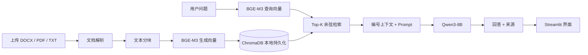

# Local RAG Learning Assistant / 本地 RAG 知识库助手

一个从零实现的本地 RAG 学习项目：把 Word、PDF、TXT 文档导入知识库，使用 BGE-M3 生成向量，通过 ChromaDB 检索相关片段，再交给本地 Qwen3-8B 生成带来源的回答。

项目目标不是封装一个现成框架，而是亲手走通 RAG 的每一个环节，理解文档解析、分块、Embedding、向量检索、Prompt 组装和拒答分别解决什么问题。

## 功能

- 支持 `.docx`、`.pdf`、`.txt` 文档导入。
- 使用 `python-docx` 和 PyMuPDF 提取文字，保留来源、页码或段落元数据。
- 按约 500 字符分块，块间保留约 80 字符重叠。
- 使用 Ollama 的 `bge-m3-cpu` 在 CPU 上生成 1024 维向量。
- 使用 ChromaDB `PersistentClient` 保存知识库，程序重启后数据仍然存在。
- 使用余弦相似度执行 Top-K 检索。
- 使用 Ollama 的 `qwen3:8b` 基于检索内容生成回答。
- 资料不足时明确拒答，不要求模型凭常识补全。
- 回答下方展示实际检索来源，可展开查看原文块。
- 提供 Streamlit 单页界面，以及命令行建库、问答和检索评估工具。

## 技术栈

| 组件 | 选择 | 作用 |
|---|---|---|
| 语言 | Python 3.12 | 项目开发 |
| 环境与依赖 | `uv` + `.venv` | 隔离环境、锁定依赖 |
| 大语言模型 | Qwen3-8B (`qwen3:8b`, Q4_K_M) | 根据检索资料生成回答 |
| 推理服务 | Ollama | 提供本地 LLM 和 Embedding HTTP API |
| Embedding | BGE-M3 (`bge-m3-cpu`) | 文档块和问题的向量化 |
| 向量数据库 | ChromaDB 1.5.9 | 本地持久化存储与语义检索 |
| Word 解析 | `python-docx` | 提取 DOCX 段落 |
| PDF 解析 | PyMuPDF | 提取 PDF 文字和页码 |
| Web UI | Streamlit | 上传文档、管理知识库和聊天 |
| 测试与检查 | `pytest`、`ruff` | 自动化测试、格式和静态检查 |

## 架构



### 建库流程

1. 上传文档并保存原始文件。
2. 根据后缀选择 TXT、DOCX 或 PDF 解析器。
3. 清洗空白并按字符窗口分块，保留少量重叠。
4. 用 BGE-M3 生成每个文本块的向量。
5. 将文本、向量和元数据写入 ChromaDB。

### 问答流程

1. 用同一个 BGE-M3 模型把问题转成向量。
2. ChromaDB 返回余弦相似度最高的 Top-K 文本块。
3. 按编号把检索结果拼成上下文。
4. Qwen3-8B 只根据上下文回答，并标注引用编号。
5. 界面展示回答和实际检索来源；资料不足时显示拒答。

## 快速开始

### 1. 环境要求

- Windows 11（当前实测环境）
- Python 3.12
- [uv](https://docs.astral.sh/uv/)
- Ollama 0.32+
- 已安装 `qwen3:8b` 和 `bge-m3-cpu` 模型

### 2. 安装依赖

```powershell
uv sync
```

### 3. 准备模型

如果本机还没有模型，可以在 Ollama 中准备：

```powershell
ollama pull qwen3:8b
ollama pull bge-m3
ollama create bge-m3-cpu -f Modelfile.bge-m3-cpu
```

`bge-m3-cpu` 是从 `bge-m3` 派生的 CPU-only 模型，避免 Embedding 和 Qwen 争抢显存。模型文件较大，不建议提交到 Git。

### 4. 启动 Ollama

```powershell
ollama serve
```

### 5. 检查环境

```powershell
uv run python scripts/check_env.py
```

### 6. 启动 Web 界面

```powershell
uv run streamlit run app/ui.py
```

浏览器打开 `http://localhost:8501`。如果是远程或容器环境，使用 Streamlit 输出的 Network URL。

## 使用方式

### Web UI

1. 在左侧上传一个或多个文档。
2. 点击“导入到知识库”。
3. 在聊天框输入问题。
4. 展开回答下方的“查看来源”，检查实际检索片段。
5. 可在左侧删除单个来源索引。

注意：当前来源标识使用文件名，同名文件会覆盖旧索引。删除索引不会删除 `data/uploads` 中的原始文件。

### 命令行建库

```powershell
uv run python scripts/ingest.py data/uploads/demo.txt
uv run python scripts/ingest.py --chunk-size 500 --overlap 80
```

不传路径时，会读取 `data/uploads` 中所有支持的文档。

### 命令行问答

```powershell
uv run python scripts/query.py "What is this local knowledge base sample about?"
```

只做检索、不调用 Qwen：

```powershell
uv run python scripts/query.py "PDF 里写了什么？" --retrieval-only --top-k 5
```

调整上下文预算：

```powershell
uv run python scripts/query.py "问题" --top-k 5 --max-context-chars 6000
```

### 检索评估

如果本地保留了评估数据集，可以运行：

```powershell
uv run python scripts/evaluate_retrieval.py --dataset data/eval/mianyang_synthetic_v1 --top-k 5
```

当前合成测试集包含 8 份完全虚构的规则文档、113 条虚构规则和 40 条问题。它只用于测试检索链路，不能作为真实学校规定。

## 评测结果

当前 40 条合成问题的检索基线：

| 指标 | 结果 |
|---|---:|
| Hit@5 | 1.0000 |
| Recall@5 | 1.0000 |
| Precision@5 | 0.2176 |
| MRR@5 | 0.9559 |
| 失败问题数 | 0 |

`Precision@5` 偏低，主要是因为很多问题只有一条证据，而 Top-5 会带回同主题的相邻文本块。这个结果不能直接代表真实长篇文档上的检索质量。

## 测试

```powershell
uv run pytest -q -p no:cacheprovider
uv run ruff check .
uv run ruff format --check .
uv run python scripts/check_env.py
```

当前全量测试：`82 passed`。

## 项目结构

```text
RAG_LEARNING_PROJECT.md   # 详细规划、环境、阶段记录和变更日志
README.md                 # GitHub 项目入口
LEARNING_NOTES.md         # RAG 学习笔记
pyproject.toml
uv.lock
env.example
.gitignore
Modelfile.bge-m3-cpu

app/
  config.py          # 模型、路径、Top-K、分块和生成参数
  loaders.py         # TXT / DOCX / PDF 解析
  chunking.py        # 文本分块
  embeddings.py      # Ollama BGE-M3 Embedding
  vector_store.py    # ChromaDB 存储、读取、删除和检索
  ingestion.py       # CLI 与 UI 共用的入库服务
  retrieval_eval.py  # 检索指标与证据映射
  llm.py             # Ollama Qwen 客户端
  rag.py             # 上下文构造、Prompt、拒答和问答
  ui_helpers.py      # 上传校验与来源格式化
  ui.py              # Streamlit 单页界面

scripts/
  check_env.py
  ingest.py
  query.py
  evaluate_retrieval.py

tests/
  test_loaders.py
  test_chunking.py
  test_embeddings.py
  test_vector_store.py
  test_retrieval_eval.py
  test_llm.py
  test_rag.py
  test_ingestion.py
  test_ui_helpers.py
  test_ui.py
```

## 配置

默认参数在 `app/config.py` 中，常用环境变量见 `env.example`：

- `OLLAMA_BASE_URL`
- `LLM_MODEL`
- `EMBEDDING_MODEL`
- `CHROMA_PATH`
- `TOP_K`
- `CHUNK_SIZE`
- `CHUNK_OVERLAP`

当前版本直接读取系统环境变量，`env.example` 只是变量清单，不会自动加载 `.env`。在 PowerShell 中可以临时设置：

```powershell
$env:CHROMA_PATH = "data/chroma"
```

如需使用独立知识库测试，例如虚构学校规则集：

```powershell
$env:CHROMA_PATH = "data/eval/mianyang_synthetic_v1/runtime_chroma"
uv run streamlit run app/ui.py --server.port 8502
```

## 设计取舍

- 不引入 LangChain、LlamaIndex：核心流程直接写在 `app/` 中，方便观察每一步。
- 不做前后端分离：Streamlit 足够支撑个人学习项目。
- Embedding 放 CPU：给 Qwen 留出 8 GB 显存。
- 单轮问答：V1 不保存聊天历史，避免把会话记忆与知识库检索混在一起。
- 文件名为来源标识：实现简单，但同名文件会覆盖；后续可升级为 `doc_id` 或文件哈希。
- 不做自动引用校验：来源列表独立展示，模型编号写错时仍能追溯实际片段。

## 已知限制

- 扫描版 PDF 没有文字层时无法解析，需要 OCR，V1 不支持。
- DOCX 只读取正文段落，不读取表格、页眉和页脚。
- 聊天历史只保存在 Streamlit Session State，刷新新会话后不保留。
- 当前来源唯一标识是文件名，同名文件会覆盖旧索引。
- 检索结果没有相似度阈值，低相关候选也会进入 Top-K，因此拒答时仍可能显示低分来源。
- 合成评估集规模有限，不能替代真实文档评估。

## 相关文档

- [学习笔记](LEARNING_NOTES.md)
- [项目规划与实现记录](RAG_LEARNING_PROJECT.md)

## 说明

这是一个个人学习项目，重点是可理解、可验证的最小 RAG 实现，不是生产级知识库系统。
